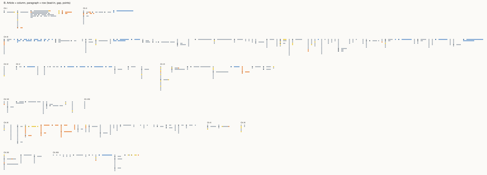
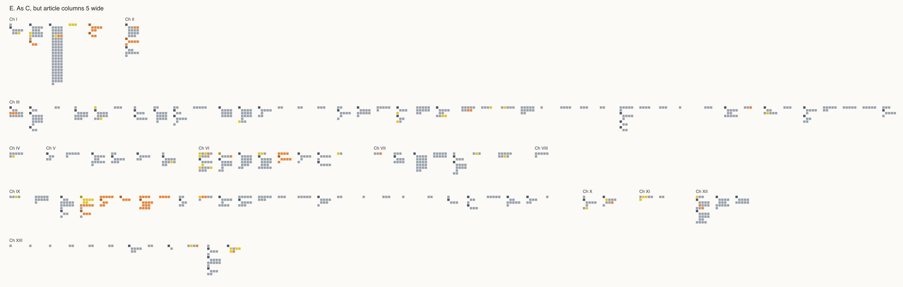
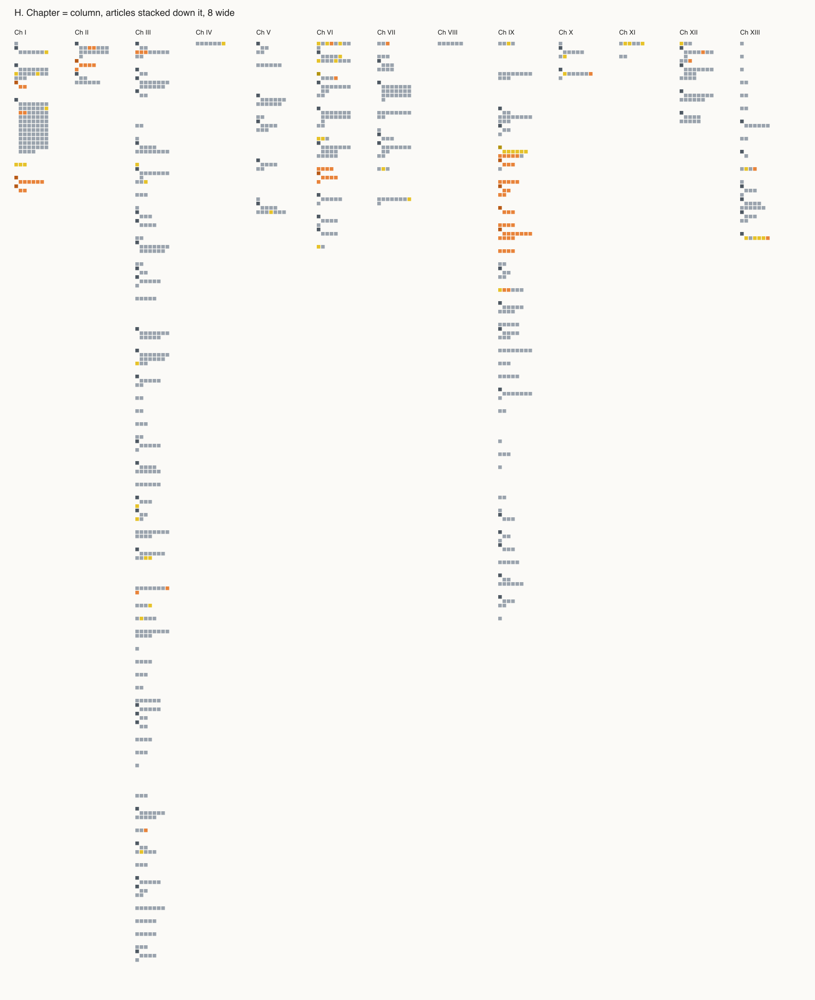
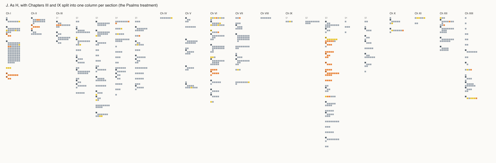
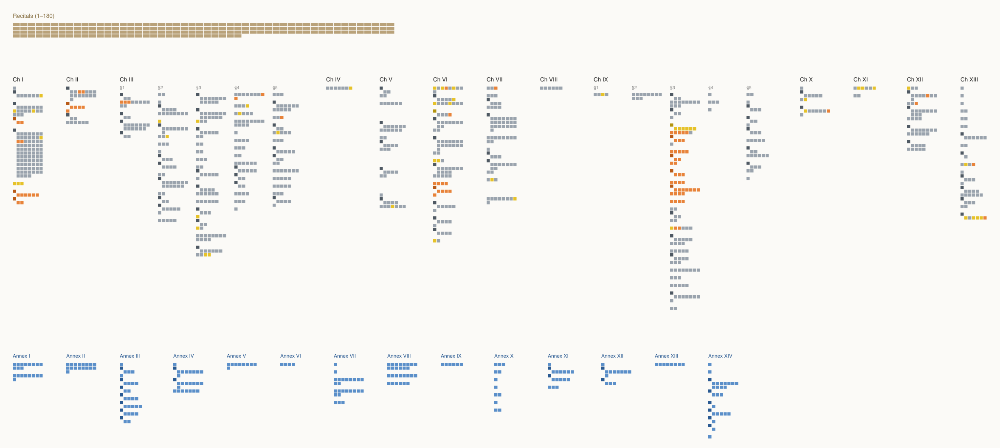
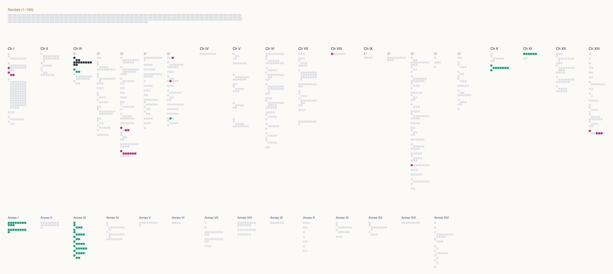

# EU AI Act Map

**Date:** 2026-10-13
**Status:** Exploration. Layout decided 2026-10-13; nothing built in the app.
Data and scripts: `experiments/eu-ai-act/`.

Can the Torah Map's model — every unit of a text in a fixed place, with
overlays on top — show a very different text? We tried it on the EU AI Act:
Regulation (EU) 2024/1689, as amended by Regulation (EU) 2026/1744.

## The text

The Act comes in three parts, in this order:

- **Recitals** — 180 numbered paragraphs explaining why each rule exists.
  Courts read them to interpret the articles, but they bind no one. They talk
  about the Act's ideas and almost never cite its articles by number: of 30
  that name an "Article", most mean the EU treaties or the GDPR.
- **Articles** — the rules: 13 chapters, some split into sections, then 119
  articles, numbered paragraphs, and lettered points.
- **Annexes** — 14 lists and procedures the articles reach into. Every annex is
  cited by at least one article; none cites back.

The consolidated text, where the amendment is folded in, leaves out the
recitals by convention, so they come from the 2024 Official Journal text. The
2026 amendment has recitals of its own, which explain the articles it inserted
(4a, 60a, 75a–d); we have not fetched them.

At about 1,500 squares, the whole Act is a fifteenth the size of the Tanakh.

## Decisions

**A square is the smallest piece**: a paragraph with no points, the lead-in
sentence of a list, or one point. That is 1,075 squares in the articles and
264 in the annexes. A paragraph groups its squares, as an article groups its
paragraphs.

**Inside an article**, plain paragraphs flow along a line and wrap. A paragraph
with a list starts a new line: its lead-in alone, then its points wrapped
densely beneath, indented. Giving each paragraph its own row turned runs of
plain paragraphs into tall poles of single squares (Article 2's paragraphs
2–12, Article 5's 3–8):

Wrapping them fixes that:

**Articles stand in chapter columns, eight squares wide**, as the Tanakh's
books stand in columns of chapters. Chapter III, on high-risk systems, holds 44
of the 119 articles, which makes its column about four times the height of
most others:

So **Chapters III and IX split into one column per section**, as Psalms splits
into columns:

**The three parts are three layers**, recitals over articles over annexes, as
Torah, Prophets and Writings stack. A recital is a 2×1 tile, wider than a
square but no taller: it is a paragraph, and runs to about 154 words against a
square's 34. Annexes are blue, so nothing mistakes them for articles. Here the
articles are coloured by the 2026 amendment: orange inserted, yellow replaced.

**Rejected:** a floor plan shaped like the Act's pyramid of risk tiers. Only
four of the thirteen chapters are tiers, and by length the pyramid is the
wrong shape — the banned tier is one article, high-risk is 44, the bottom tier
is empty. Also tried and dropped: chapters flowing onto shelves, with sections
as rows; Chapter III ran too wide.

**Deferred:** marking that a split chapter's columns belong together; a mapping
from recitals to the articles they explain; placing each annex beside the
article that cites it most.

## What points here

The articles make 845 references to the Act's own articles and annexes, found
and resolved by `refs.py`: 351 to a paragraph, 32 to a point, 312 to a whole
article, 148 to an annex. Every one resolves to a unit that exists. A sample
read against the text was right, once references to other laws ("Article 4,
point (1), of Regulation (EU) 2016/679") were told apart.

Article 6, which decides what is high-risk, in dark; green is what it cites,
magenta what cites it:

## Open

- **Search.** Three jobs look worth having: the 70 defined terms of Article 3
  as terms, not words; who carries a duty — provider, deployer, importer,
  notified body; and what points here.
- **Overlays.** The amendment, shown above. Also: when each part applies
  (Article 113 sets different dates for different parts); "shall" against
  "may"; where the Commission is told to fill in detail later; which
  obligations each penalty in Article 99 enforces; recitals per article, once a
  mapping exists.
- **The app.** `createApp(text)` already takes a text, so the Act would be a
  third text beside the Tanakh and the Talmud, not a fork.
