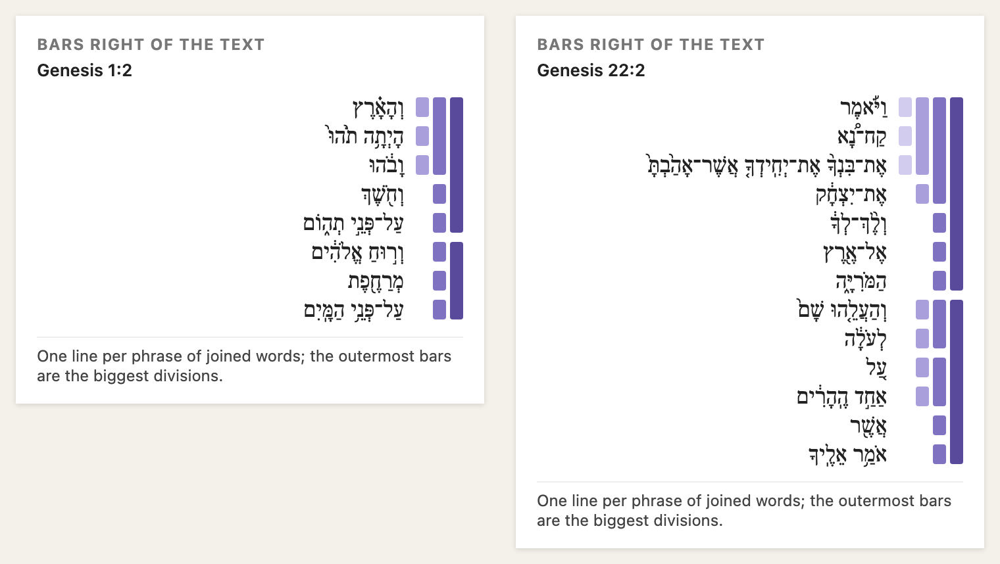

# The pinned verse's trop tree

**Issue:** #440
**Date:** 2026-11-27
**Status:** Design, waiting for approval.

## Why

Trop works like punctuation. Each verse is divided at its etnachta, each half again at its
strongest pauses, and so on down to phrases whose words are joined by connecting marks. Nothing
on the map shows that structure today. Pinning a verse with the Trop overlay on should show how
the trop breaks that verse into phrases. This view also makes a later overlay of unusual verse
division (#363) explainable. That overlay is not part of this work.

## What it shows

- **One line per phrase.** A phrase is a run of words with no pause inside, such as *hayeta tohu*
  or *veruach elohim* in Genesis 1:2. The phrases run top to bottom in reading order, with the
  text right-aligned.
- **Bars on the right of the text.** Each piece of the verse has a bar spanning its lines, down
  to the single phrases. The outermost bar on the right is the verse's first division, into
  halves; each column inward is one step deeper.
- **No mark names.** The bars carry the structure. The marks stay visible in the pointed text.
- **Structure only.** No colors for rarity. Those come later, with #363.

## Approaches considered

Sketches of each are on #440.

- A top-down tree. This was the clearest on short verses, but long verses ran out of width in the sidebar.
- A dendrogram beside the words. It was rejected because the bars read better.
- An indented outline (one line per piece, nested). It was easy to read but repeated the text at every level.
  Keeping each set of joined words on one line comes from this sketch.
- Strokes at each pause in the running text. This was the lightest option, but it showed where the pauses fall and not how they nest.
- **Bars beside the text, one line per phrase: chosen.**

## How the verse splits

The splitting is the one on the `verse-division` branch (`pieces()` in
`scripts/overlays/text-analytics/measures.ts`):

- Split a piece at the strongest pause inside it. The piece's last word is not counted, since it
  ends the piece.
- Where several words carry that pause, split at each of them.
- Recurse until a piece has no pause inside.
- The levels are the traditional four (Emperors, Kings, Dukes, Counts), which main's
  `trop/marks.ts` already records as each prose mark's group.
- Legarmeh, a munach followed by a paseq, counts as a Count.
- A maqaf-joined group is one word.

## My calls, which you can override

- **Where it appears:** in the Trop overlay's panel, for the pinned verse only, not the hovered one.
  It uses the overlay's existing hook for this (`renderFocus`).
- **No new data file.** The tree is computed in the browser from the verse text the overlay
  already loads.
- **Prose books only.** Psalms, Proverbs and Job, apart from Job's prose frame, use other marks.
  There the panel says in one line that the tree covers the prose books. The overlay's existing
  `systemOf` decides which system a verse uses.
- **Code location:** the splitting moves into `apps/tanakh/src/overlays/trop/` beside the marks,
  so a later rarity overlay can reuse it.

## Left to the builder

- Bar colors and widths, taken from the overlay's existing palette.
- What a verse with no pause at all shows: one line and one bar is fine.
- How the ketiv and qere appear: as the sidebar's verse text shows them.
- Tests: the splitting on known verses (Genesis 1:2's eight phrases and its nesting), and a
  layout state for the panel's screenshot.
